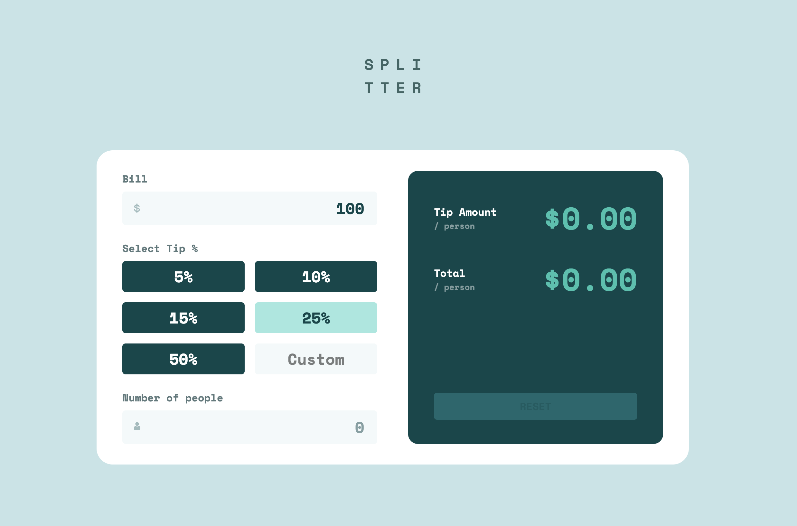

# tip-calculator-app

A responsive Tip calculator app built as part of a Frontend Mentor challenge.

- Live: [GitHub Pages](<>)
- Code: [GitHub](https://github.com/kirilenko-a/tip-calculator-app)

## Built with

- Semantic HTML 5
- Javascript(ES6+)
- Tailwind CSS v4
- CSS Grid
- Flexbox
- Responsive design
- Vite

## Features

- Calculate tip and total amount per person
- Choose from predefined tip percentages
- Enter a custom tip percentage
- Real-time calculation updates
- Input validation with error messages
- Reset the calculator
- Responsive layout for mobile and desktop screens

## Author

- [GitHub](https://github.com/kirilenko-a)
- [Frontend Mentor](https://www.frontendmentor.io/profile/kirilenko-a)
